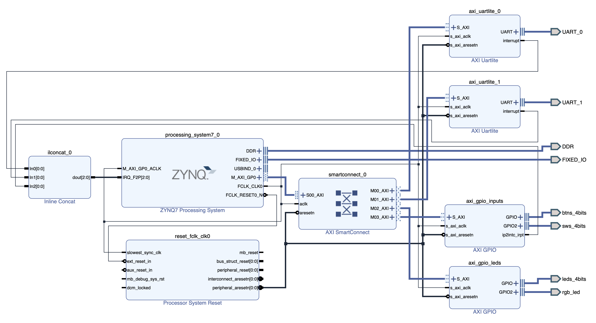

# Overview

This crate provides the following features:

- A runtime environment designed to be booted from U-Boot
- `print!()` / `println!()` output over UART
- Collection of context information when an exception occurs
- Multi-core operation

It implements the foundation of a bare-metal system.

# Implementation Policy

Crates intended for bare-metal use on the ZYNQ-7000, such as `zynq7000`, `zynq7000-hal`, and `zynq7000-rt`, have already been published. However, the examples built with them assume that the system is booted from the BootROM.

In real-world development it is more convenient to boot from U-Boot, so I implemented this crate on the assumption that it is booted from U-Boot.

Device definitions come from the `zynq7000` crate. In addition, `zynq7000-hal`, `aarch32-cpu`, and `aarch32-rt` are used, and some of the build-environment files are borrowed from them.

The bootstrap code, exception handling, and drivers are implemented additionally.

# Environment

- **Board**
  - [Zybo Z7-20](https://digilent.com/shop/zybo-z7-zynq-7000-arm-fpga-soc-development-board/)
- **Parts**
  - [Pmod USBUART](https://digilent.com/reference/pmod/pmodusbuart/start) x2
- **Tools**
  - Vivado 2025.1
  - Vitis 2025.1
  - rustc 1.99.0
  - cargo 1.99.0
- **Host OS**
  - Ubuntu 24.04 Desktop

# Block Design

The Block Design used for verification is shown below.



It includes two UART Lite instances for the console and two AXI GPIO instances for LED control and Switch/Button input. The UARTs are connected to the Pmod USBUARTs, but the example also works with only the on-board UART if you do not have them.

The Pmod USBUART connections are as follows.


# Vivado Build Procedure

## Creating the Bitstream

First, generate the bitstream with Vivado. Start by fetching the set of scripts with the following commands.

```bash
cd $HOME
git clone -b pmod-usbuart-x2 https://github.com/hkato-sssl/zybo-z7-20-example.git
```

Next, run the fetched script in Vivado. The script can be run entirely from the CLI.

```bash
source /tools/Xilinx/2025.1/Vivado/settings64.sh
cd $HOME/zybo-z7-20-example
vivado -source vivado/script/zybo-z7-20-example.tcl -mode batch
```

If you remove Vivado's `-mode batch` option, it runs in the GUI.

The Vivado project is created in `$HOME/ws/vivado/zybo-z7-20-example/`.

When the script finishes successfully, `zybo-z7-20-example.xsa` is created under the project directory.

# PetaLinux Build Procedure

Using the XSA file created above, build Linux and U-Boot. Linux is not used in this article, but it is built here for verification purposes.

## Prerequisites

The procedure assumes the following conditions.

- The PetaLinux tools are available.
- `zybo-z7-20-example.xsa` has been copied to your home directory.

## Preparation

First, set the environment variables. Here, the project is created under `$HOME/petalinux/`.

```bash
WORK_DIR=$HOME/petalinux
PROJ_NAME=zybo-z7-20-example
PROJ_DIR=$WORK_DIR/$PROJ_NAME
PROJ_XSA=$HOME/$PROJ_NAME.xsa
```

## Creating the Project

Next, create the project and import the XSA file created earlier.

```bash
mkdir -p $WORK_DIR
cd $WORK_DIR
petalinux-create project --template zynq --name $PROJ_NAME
cd $PROJ_DIR
petalinux-config --get-hw-description $PROJ_XSA --silentconfig
```

## Build

After building PetaLinux and U-Boot, create BOOT.BIN.

```bash
petalinux-build
petalinux-package --boot --fsbl images/linux/zynq_fsbl.elf --fpga images/linux/system.bit --u-boot --force
```

# Rust Build Procedure

## Preparation

Install the Rust toolchain. Installation can be done with user privileges.

First, install the tools required for the installation on Ubuntu.

```bash
sudo apt update
sudo apt install curl git build-essential
```

Next, download and run the Rust installation script.

```bash
curl --proto '=https' --tlsv1.2 -sSf https://sh.rustup.rs | sh
```

To enable the paths of the installed tools, log out and log back in. After logging back in, install the additional tools.

```bash
rustup target add armv7a-none-eabihf
cargo install cargo-binutils
rustup component add llvm-tools
```

At the time of writing, version 1.99.0 was installed.

```bash
$ rustc --version
rustc 1.99.0 (b940084d7 2026-09-28)
```

## Build

Once Rust is installed, fetch the source and build it.

```bash
cd $HOME
git clone https://github.com/hkato-sssl/zynq7000-baremetal-rs.git zynq7000-baremetal
cd zynq7000-baremetal
cargo build -r
```

Since the crate name is `zynq7000-baremetal`, the folder name is matched to the crate name at `git clone` time. The build works even if the folder name and the crate name differ.

The build is successful when the two files `hello` and `ttc` are generated under `target/armv7a-none-eabihf/release/`. Finally, convert them to BIN format.

```bash
cargo objcopy --release --bin hello -- -O binary hello.bin
cargo objcopy --release --bin ttc -- -O binary ttc.bin
```

After running these commands, `hello.bin` and `ttc.bin` are generated in the project directory.

# Running the Examples

## Creating the Boot SD Card

Write the following files created in the [PetaLinux build procedure](#petalinux-build-procedure) to the FAT partition of the microSD card.

- BOOT.BIN
- boot.scr
- image.ub

`image.ub` is a Linux image. It is written only to verify the FPGA in case the system does not boot, and it is not required.

Next, write the BIN files created with Rust.

- hello.bin
- ttc.bin

Once everything is written, insert the SD card into the Zybo's slot and power on the board.

## Running hello.bin

### Boot Procedure

After powering on the board, run the following command from U-Boot.

```bash
fatload mmc 0:1 0x10000000 hello.bin;dcache flush;go 0x10000000
```

When it runs, the string HELLO is output continuously from the on-board UART, as shown below.

```
0:HELLO#3681
1:HELLO#3681
0:HELLO#3682
1:HELLO#3682
0:HELLO#3683
1:HELLO#3683
....
```

The number at the beginning of each line is the core number that produced the output. The string is output from both Core#0 and Core#1, so the core number is included to tell the sources apart.

The number at the right end is the number of loop iterations on each core. In this example output, the cores acquire control of the UART alternately, which produces this pattern. Depending on the circumstances, only Core#0 may produce output, or vice versa.

Mutual exclusion is implemented with the `critical-section` crate, and the architecture-dependent part is implemented in [critical_section.rs](https://github.com/rust-embedded/aarch32/blob/main/aarch32-cpu/src/critical_section.rs) of the `aarch32-cpu` crate.

On Arm, using the `sev`/`wfe` instructions is recommended when implementing a spin lock, but they are not used here. I do not know whether this is the cause, but a phenomenon where only one core keeps acquiring control can be observed.

To make the cores acquire control as evenly as possible, `sev`/`wfe` is executed in the loop that outputs the string. The effect is quite marginal, but it seems to help a little.

### Switching the Output UART

The output destination of `println!()` can be switched with `[features]` in Cargo.toml.

```
default = ["uart-console-shared"]     # All output goes to the on-board UART
default = ["uart-console-exclusive"]  # Each core outputs to its own Pmod USBUART
```

If you change it to **uart-console-exclusive** and rebuild, the output of `println!()` is separated per core.

## Running ttc.bin

After powering on the board, run the following command from U-Boot.

```bash
fatload mmc 0:1 0x10000000 ttc.bin;dcache flush;go 0x10000000
```

`ttc.bin` implements timer interrupt handling. At present, features such as determining the interrupt source and managing handlers are not implemented, and the IRQ handler is implemented directly.

When the program runs, each core dumps the GIC register state and then outputs `*` at one-second intervals.

The timer interrupt is generated using the PS's built-in TTC (Triple Timer Counters). The interrupt handler runs on Core#0 and sets the `AtomicBool` SIGNAL to true on every interrupt. When Core#1 detects the change in SIGNAL, it outputs a character to the UART.

# Implementation Overview

## Source Layout

This is implemented as a library crate, with the examples placed under `src/bin/`.

```
/
├── build.rs              - Build script
├── memory.x              - Linker script
└── src
    ├── bin
    │   ├── hello.rs      - UART test example
    │   └── ttc.rs        - Interrupt test example
    ├── boot              - Bootstrap codes
    │   ├── mod.rs
    │   ├── secondary.rs
    │   └── startup.rs
    ├── cache
    │   ├── l1.rs         - L1-$ driver
    │   ├── l2.rs         - L2-$ driver
    │   └── mod.rs
    ├── cpu
    │   ├── mod.rs
    │   └── register      - System register access library
    │       ├── mod.rs
    │       ├── ttbcr.rs
    │       └── ttbr1.rs
    ├── debug.rs          - Debug library
    ├── device.rs         - Define device instance
    ├── driver
    │   ├── axi_gpio.rs   - AXI GPIO driver
    │   ├── mod.rs
    │   ├── slcr.rs       - SLCR driver
    │   ├── uartlite.rs   - AXI UART Lite driver
    │   └── xpsuart.rs    - PS UART driver
    ├── exception
    │   ├── abt_handler.rs - Abt mode exception handler
    │   ├── mod.rs
    │   ├── svc_handler.rs - Svc mode exception handler
    │   └── und_handler.rs - Und mode exception handler
    ├── lib.rs
    ├── macros.rs          - Define macros
    ├── mmu.rs             - Define the MMU description table
    └── pl.rs              - Define device instances in PL
```

## Bootstrap

### Primary Core

Implemented in `src/boot/startup.rs`. It assumes booting from U-Boot: it first disables the MMU and initializes the caches, and then performs processor initialization.

### Secondary Core

Secondary core startup is based on the [Linux implementation](https://elixir.bootlin.com/linux/v7.2.9/source/arch/arm/mach-zynq/platsmp.c#L30-L81).

The `zynq7000-rt` crate also implements secondary core startup, but it apparently assumes booting from the BootROM and did not work well here.

In this implementation, the secondary core starts from address `0000_0000h`, so a startup vector table is written to this address. As a consequence, starting the secondary core corrupts a few bytes of memory starting at `0000_0000h`.

Once the secondary core is started, `kmain_secondary()` is executed after the stack pointer is initialized.

## Cache Control

`l1.rs` is a wrapper around the APIs provided by the `aarch32-cpu` crate. In `aarch32-cpu`, the cache-related APIs are implemented as generic functions, and generic parameters must be specified at run time. Specifying the parameters is a bit tedious, so I prepared a wrapper.

`l2.rs` is a new implementation. In addition, `cache.rs` provides APIs that operate on both L1 and L2.

Cache control is also implemented in the `zynq7000-hal` crate, but I implemented it myself for the personal reason of wanting to keep names and so on consistent with my earlier implementations.

## System Register Control

`aarch32-cpu` provides APIs for accessing system registers, but some system registers are not covered. I implemented the unsupported ones myself, in the same style as the `aarch32-cpu` crate.

## Debug Features

For `panic!()` and debugging, LED control APIs and a GIC register dump function are provided.

Since these features are intended for emergency and debugging use, **they do not take mutual exclusion of device access into account**, so care is needed when using them. All APIs provided by `debug.rs` are defined as `unsafe`.

## Device Definitions

The instance definitions of the devices used by the system are gathered here. Only devices in the PS are defined here. Each instance definition uses `critical_section::Mutex` for mutual exclusion between cores.

## Drivers

Implementations of various drivers are placed under `src/driver/`. Most drivers do not take mutual exclusion between cores into account. Mutual exclusion is expected to be handled by the caller.

The drivers currently provide only the minimum functionality required to run the examples.

## Exception Handling

Handlers for the various exceptions are implemented. Exception handling is implemented in the `aarch32-rt` crate, but I implemented it myself because I wanted to pass the context information at the time of the exception to the handlers.

The context information passed to the handlers is defined in `src/exception/mod.rs`.

An example of the exception output is shown below.

```
#### Undefined instruction exception ####

   SPSR: 0x2000015F
     PC: 0x100000F4
     R0: 0x00000001
     R1: 0xFFFFFFFF
     R2: 0x00000000
     R3: 0x00000001
     R4: 0x3EADC414
     R5: 0x10000000
     R6: 0x00000002
     R7: 0x00000000
     R8: 0x3FFE8E18
     R9: 0x3EAD1EC0
R10(SL): 0x00000002
R11(FP): 0x1FFFBFF8
R12(IP): 0x00007FFF
 USR SP: 0x1FFFBFE8  LR: 0x1000441C
 ABT SP: 0x1FFEC000  LR: 0x00000000
 FIQ SP: 0x1FFF8000  LR: 0x00000000
 IRQ SP: 0x1FFF4000  LR: 0x00000000
 SVC SP: 0x1FFE4000  LR: 0x3FF013C4
```

## Macro Definitions

`print!()` and `println!()` are defined here. Through configuration, you can choose the output destination: a UART shared by all cores, or a dedicated UART for each core.

You can change the output destination of `println!()` by modifying the code here.

## MMU Descriptor Definition

This is implemented based on the `aarch32-cpu` crate. Mapping is possible only in units of sections. In the `aarch32-cpu` crate, the code was written separately for each mapping. Here, the mapping can be changed by modifying the definition of [INITIAL_MAP](https://github.com/hkato-sssl/zynq7000-baremetal-rs/blob/main/src/mmu.rs#L39-L71).

Currently, the MMU descriptors are only generated statically; there is no feature for changing the mapping dynamically while the system is running.

## PL Device Definitions

Like `device.rs`, this gathers the instance definitions of devices in the PL. The PL implementation changes from system to system, so it is defined separately from the PS.

# Areas for Improvement

## Per-Device Mutual Exclusion

This implementation uses `Mutex` and `with()` from the `critical-section` crate for mutual exclusion between cores. Mutual exclusion is guaranteed while `with()` is running, but judging from the implementation, it is a giant lock: exclusion is applied across the entire `critical-section` crate rather than per `Mutex<T>` definition. If `critical-section` is used in, for example, the UART and Ethernet drivers, exclusion is applied across drivers rather than per device, which hurts execution efficiency.

The optimal granularity for driver mutual exclusion is per device, so a dedicated implementation seems necessary. Since atomic types (`core::sync::atomic`) are available, a spin-lock style implementation should have a low barrier to entry.

## Executable Image Size

The BIN image is around 2 MiB. The cause is the `L1Table` type used in `mmu.rs`. This type is [specified with 1 MiB alignment in the `aarch32-cpu` crate](https://github.com/rust-embedded/aarch32/blob/main/aarch32-cpu/src/mmu.rs#L11-L18).

`SYS_L1_PAGE_TABLE` is created by `build_initial_l1_table()`, and compiling this results in two `L1Table` data objects in `mmu.rs`:

- `SYS_L1_PAGE_TABLE`
- `desc` inside `build_initial_l1_table()`

Aligning these two data objects makes the `.data` section 2 MiB in size.

If the size is a concern, the way `SYS_L1_PAGE_TABLE` is generated needs to be changed.

# Related Article

https://qiita.com/hkato-sssl/items/a66dbb4f533f0adda416

